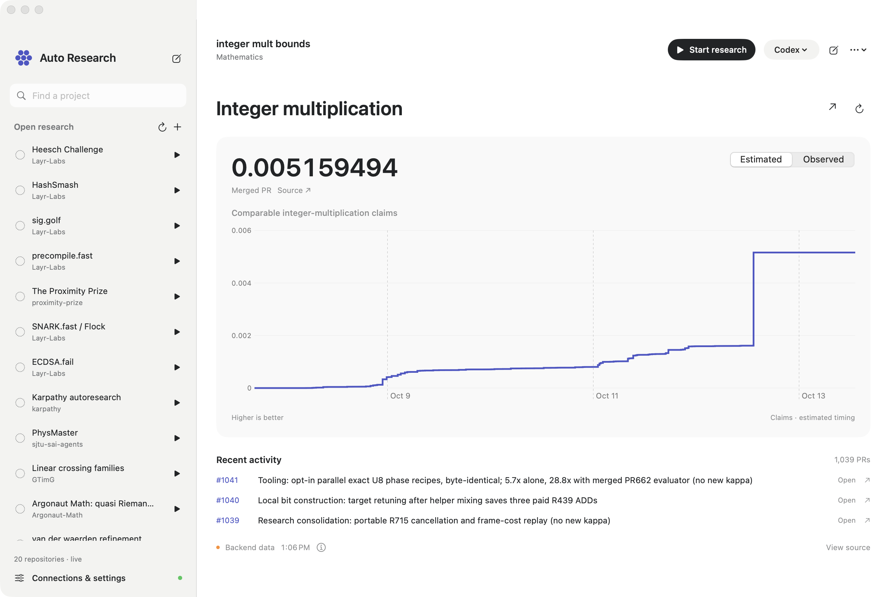
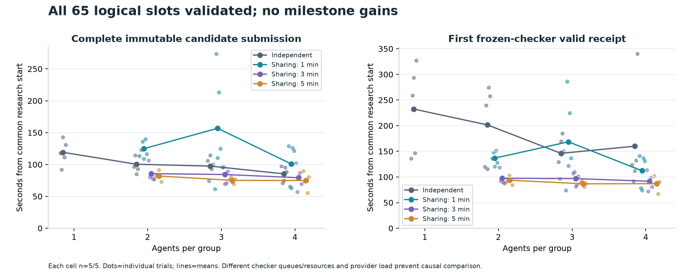
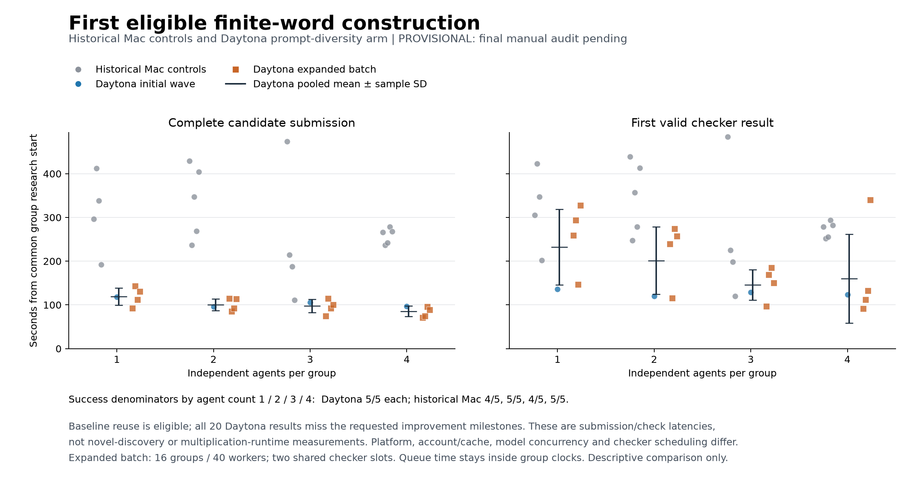
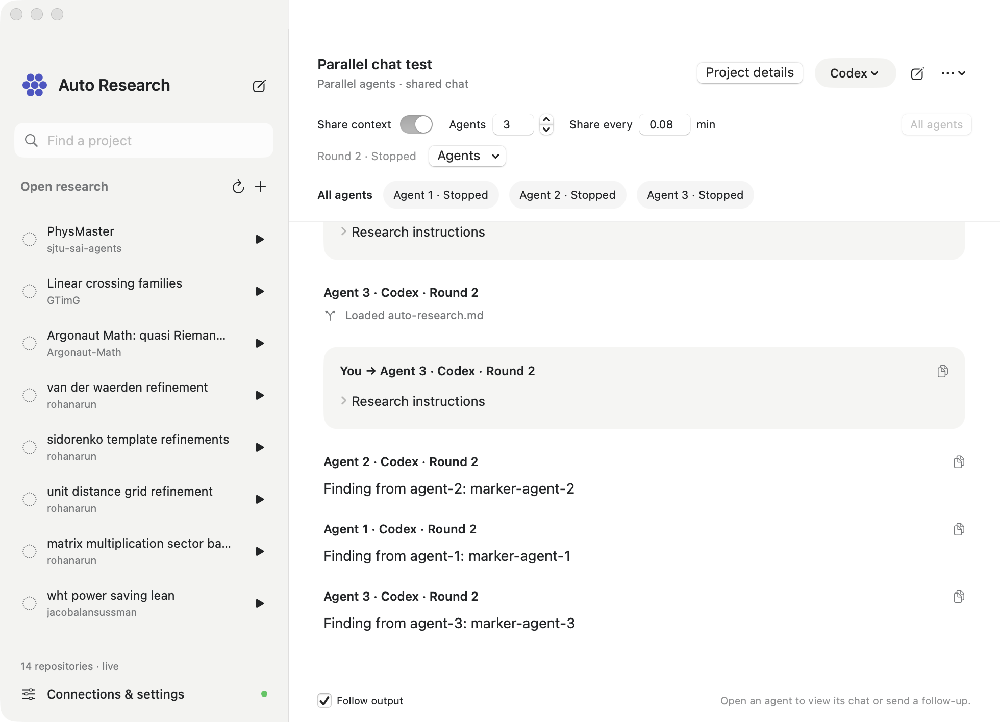

# Auto-research agent

The idea is to make it dead simple to point your Codex, Claude or OpenCode at open problems, put unused tokens to work, and help push the frontier.

Auto-research agent is a native macOS app with a Codex-style project sidebar and chat. It helps you find GitHub projects with `auto-research.md` agent guides and makes starting a contribution a one-button click: pick an open problem and press Play.

It runs the Codex, Claude Code or OpenCode CLI under the hood, using your own account. If your chosen CLI is already installed and logged in, you can start immediately after the app's initial workspace setup, with no separate login needed.



## Download

[Download for macOS — Apple Silicon (.dmg)](https://github.com/rohanarun/Auto-research-agent/releases/download/v1.4.0/Auto-research-agent-1.4.0-arm64.dmg) · [SHA-256 checksum](https://github.com/rohanarun/Auto-research-agent/releases/download/v1.4.0/Auto-research-agent-1.4.0-arm64.dmg.sha256)

Requires macOS 14 or newer. The app and disk image are Developer ID signed and Apple notarized. Open the DMG, drag **Auto Research** into Applications, and launch it. On first launch, choose a folder on a mounted external drive for research files, then connect your installed Codex, Claude Code or OpenCode CLI in **Connections & settings**. The download contains no account credentials or local chats.

## Daytona execution

In **Connections & settings → Daytona**, enter your Daytona API key and click
**Save key**, then **Connect**. The key is stored in macOS Keychain and is sent only
to Daytona's management API. Click **Sign in to cloud Codex** and complete the
separate official device login. The app never uploads your Mac's Codex account
files. A local CLI installation is not required for Daytona execution.

Choose **Daytona sandboxes · Codex**, then use the same Play, agent-count and Share
context controls. Each parallel agent gets a private Linux sandbox and checkout;
source snapshots preserve tracked working files and non-ignored untracked files.
Ignored dependencies and Git history are not uploaded. Public GitHub projects
without a local checkout are cloned directly in cloud workers. Claude and local
MCP connections currently run on this Mac only.

Fast sharing maintains `RESEARCH_CHECKPOINT.md` while agents work. At a handoff,
the harness drains its owned processes, saves immutable checkpoints and topic
files, joins the checkpoint text verbatim, and supplies the bundle to fresh
provider sessions in the same private checkouts. **No synthesis-model call** is
made. The old transcript-synthesis design is not a selectable app mode.

Cloud compute is billed to your Daytona account. Stop drains owned CLI work,
downloads a credential-excluded recovery archive, checks every manifest entry and
SHA-256, then stops and archives successful exports. An export failure stops
compute while preserving the original filesystem. **Stop owned cloud compute**
also reconciles this installation's labeled sandboxes after an interrupted setup;
it never deletes them or touches another installation's workers. Idle stopping is
configured in `Resources/DaytonaDefaults.json` (60 minutes by default). The app
must remain open for scheduled checkpoint handoffs.

## Optional research methods and worker chat

The **RSI-top** and **Fork and flush** checkboxes enable a model-prepared research
plan with a fixed evaluator, retained branch artifacts and fresh exploration
contexts. These methods currently support Codex and Claude locally, and Codex in
Daytona. Normal OpenCode runs remain supported. Method branches share one Daytona
sandbox; the method runner owns parallelism instead of starting another group.
Exploration uses the configured branch count; continuation follows one selected
leader. When context sharing is enabled, workers exchange explicit evidence and
peer reviews at checkpoint boundaries.

**Rounds per batch** limits one methods batch. With **Keep researching** enabled,
the coordinator reviews its results and pending work before deciding whether to
prepare another plan. This control is also available when a saved shared agent
acts as the methods coordinator. Completing a batch does not complete the user's
research objective. A phase deadline preserves the verified incumbent and lists
unfinished workspaces for independent review; it does not validate their contents.
Recovered transport diagnostics do not override a later successful terminal turn.

The editable method policy asks for pinned repository, maintainer or user scoring
criteria. Primary correctness and objective score take precedence over optional,
independently checked tie metrics. Negative research can remain useful with zero
objective gain. Without a research-value rubric, the coordinator reviews that
evidence qualitatively; file counts and test counts do not become merit points.
Constant-metric diagnostics and retained researched checkpoints expose progress
that an unchanged incumbent score would otherwise hide.
Declare metrics that may be absent with `"optional": true`; absence stays missing,
not zero. Selection metrics are always required. Initial evaluation checks the
complete frozen plan before starting any model workers.

Daytona method conversations appear in the existing chat with worker, round and
checkpoint labels. Monitoring incrementally reads bounded chunks of existing logs;
it does not invoke a model, pause workers, run evaluators or modify checkpoints.
Polling uses the configured interval and log byte budget. Reasoning and private
account payloads are excluded from the chat projection. Saved operation identities
allow a controller that was interrupted to reconnect without launching duplicate
research. Replayed worker messages update their existing transcript entries.
An observation failure preserves the remote operation; pressing Play reconnects
the saved operation. Explicit Stop still cancels owned work.

These workflows and their mechanical tests do not establish a research-quality
or speedup advantage. The downloadable release above predates these source changes.

The opt-in `scripts/benchmark_methods.py` compares ordinary continuation,
fork-and-flush, RSI and their combination on two paired finite graph-cut instances
using the configured Codex model and an independent exhaustive oracle. It saves
the protocol before launch and preserves every arm's results. The aggregate
provider-time ceiling is common, but per-invocation windows differ; interrupted
turns may omit usage totals. This small pilot cannot establish general superiority
or measure the semantic value of negative mathematical research.

```sh
# Mechanical checks: no model calls.
python3 -B -m unittest discover -s scripts -p 'test_*.py'

# Optional live model calls using your account. Choose a new output directory.
python3 -B scripts/benchmark_methods.py --settings Runtime/settings.json --output tmp/method-pilot
python3 -B scripts/analyze_methods_benchmark.py tmp/method-pilot
```

The supplementary review independently scores saved artifacts, including those
from interrupted turns, without rewriting the registered outcomes. Its command
flags require manual inspection and are not a filesystem-isolation audit. Keep
raw provider logs and account data private.

## Experiment charts

[Report, charts and machine-readable data](docs/benchmarks/2026-10-15/README.md)
include the audited 20 independent and 45 fast-sharing trials, the explicitly
partial historical Mac comparison, and an as-of provisional old-synthesis arm.
These are baseline-eligible finite-word construction checks: no milestone
improvement was demonstrated, and different resource queues and provider load
prevent causal speedup claims.




## Build from source

Requirements: macOS 14 or newer, Xcode with its Swift toolchain, Python 3, Git, and, for local execution, at least one installed CLI: [Codex](https://developers.openai.com/codex/cli), [Claude Code](https://code.claude.com/docs/en/overview) or [OpenCode](https://opencode.ai/docs). The current workflow requires a mounted, writable external volume outside iCloud-synced folders. The first build fetches the public catalog over HTTPS.

From a terminal in your external-volume development workspace:

```sh
git clone https://github.com/rohanarun/Auto-research-agent.git
cd Auto-research-agent
./scripts/build.sh
open "build/Auto Research.app"
```

Open **Connections & settings**, check the detected CLI paths, and sign in if needed. Select a provider and press a project's Play button. This is an independent app; it is not an official OpenAI or Anthropic product.

## Open the app

Open `build/Auto Research.app`. The build targets the host architecture and has been tested on Apple Silicon. Source builds are locally ad-hoc signed; the downloadable release above is signed and notarized. Keep the build and its runtime workspace on the mounted external volume.

The build generates an ignored `Resources/Defaults.json` from `Resources/Defaults.example.json`, discovering CLI executables from `PATH` and using this checkout's `Runtime/` folder. `Runtime/settings.json` stores settings after the first save. Model fields are intentionally empty so each CLI chooses its configured default. Existing runtime settings and chats are preserved.

Optional build environment variables are `RESEARCH_WORKSPACE` (an external-volume runtime directory), `RESEARCH_CODEX_PATH`, `RESEARCH_CLAUDE_PATH`, and `RESEARCH_APP_OUTPUT`. Configure these before the first build or edit CLI paths in the app. Moving an existing runtime requires preserving its files and settings; the build does not migrate active projects.

## Use it

- The top-left **Open research** list refreshes from the supplied Auto Research website. Search by project, owner or topic. A bundled source snapshot is available offline.
- Select a sidebar project to see a compact native chart from the backend, its latest claim and source, and recent PRs. Estimated and observed histories are separate; projects with multiple metrics have a metric picker. Data refreshes at the backend’s requested interval. Projects without backend data show an empty state. Existing chats remain available through **Open chat**, and **New chat** opens the message composer.
- Press the play button next to a repository to create a chat, clone into the workspace if needed, load its `auto-research.md` verbatim, and run with the selected provider. If that file is absent, the agent is explicitly told to find the repository's actual guide and report which source it uses. It must ask if no actionable objective exists.
- Type a follow-up and press **Enter** to send. **Shift+Enter** inserts a new line; Command+Enter also sends. Pasted multiline text stays intact. Follow-ups resume the exact provider session, including after relaunch. Changing providers starts a new chat.
- Click **×** beside an old chat, or choose **Close chat** from the chat menu, to remove it from the open list. Reopen it from **Closed chats** in the sidebar. Closing preserves messages, CLI session IDs, logs and checkout files. The × beside **All agents** closes the whole group. Stop active research before closing its chats.
- **Connections & settings** contains CLI paths, optional model overrides, permission settings, login and the editable research policy. Login runs the provider's official command and uses its browser flow. The app does not copy credential files. Claude requires its own sign-in.
- **MCP tools** is an explicit allowlist for direct Codex MCP connections. The app discovers configured server names and disables unselected servers for each invocation. CLI plugins are not loaded in research runs. Nothing is enabled by default, so unrelated global integrations do not start with a research session. Global Codex configuration and credentials remain unchanged.
- **Keep researching** opts into another model turn after successful completion, only when the agent explicitly decides another experiment is justified. Missing decisions, blockers, finished work and errors pause the loop. It uses `Resources/ContinuePolicy.md`. Turn it off or press Stop to end continuation. It is off by default and does not survive app restart.
- The chat menu opens the repository, checkout, raw run logs, or exact CLI session in Terminal. Stop an in-app run before opening the same session in Terminal.
- Add public GitHub repositories or existing external-SSD folders with the plus button. Existing checkouts are preserved and are never reset or automatically pulled.

## Parallel agents on the same problem

Parallel mode is optional and off by default. The initial count is two agents; optional sharing defaults to a ten-minute interval. Both are editable before starting. Each agent uses the selected Codex, Claude or OpenCode CLI and its configured model and account. Existing saved sharing groups retain their settings.

Enable **Parallel agents**, choose the count, and send one problem or start research. Every agent receives that problem in its own checkout. Leave **Share context** off for independent work: each agent runs its own session without peer notes, coordinated roles, timed interruptions, or replacement sessions. Everyone's output appears together in **All agents**, with agent labels and links to individual chats. This combined display does not feed one agent's output into another's context. Independent checkouts live under `Runtime/parallel-agents/`.

Turn **Share context** on before launch to enable checkpoint sharing and choose its interval. Each cycle drains current runs, snapshots compact checkpoints and supporting files, then passes all checkpoint contents verbatim plus an evidence index into fresh sessions. Agents retain their own checkouts and choose relevant `RESEARCH_CONTEXT/*.md` topic files by their descriptive names. There is no extra synthesis-model call. Every successor links back to its previous chat; hidden provider state is not transferred.

The **All agents** input stays visible: choose a recipient with **Send to**, draft while agents run, then stop or wait for the group to finish before sending a follow-up to that agent. Use **Stop agents** for the whole group. Sharing groups also offer **Share now**. Group settings are locked while active. In independent mode, one agent's failure does not cancel its peers; the group reports any failure once the remaining agents finish. In sharing mode, a worker or publication failure pauses the group before replacements start. Old chats and checkout files remain available, including after relaunch. Quitting asks to stop active runs. Agent behavior for independent work is editable in `Resources/IndependentAgentPolicy.md`.



Independent checkouts include committed files, dirty tracked changes, and non-ignored untracked files from the original repository. Ignored dependencies and local secrets are not copied; each agent must establish its own environment. Git submodules are not yet supported in this mode. The original checkout is preserved. Sharing context does not automatically merge code between agents: the model identifies useful changes and their locations so successors can inspect and incorporate them deliberately.

Agent count multiplies concurrent CLI usage. Each agent periodically updates a minimal `RESEARCH_CHECKPOINT.md` during research. Sharing snapshots these checkpoints and includes their contents directly in successor prompts alongside an evidence-file index, without a separate synthesis turn; successor agents still spend tokens reading the context they need. An interval can interrupt an experiment, so the editable `Resources/SharedAgentPolicy.md` asks agents to save evidence incrementally and treat interrupted work as incomplete. Context-reading instructions live in `Resources/SharedContextPolicy.md`; initial settings live in `Resources/SharedContextDefaults.json`. Snapshots and agent checkouts are stored under `Runtime/shared-context/`.

## Permissions and evidence

Codex defaults to the workspace-write sandbox; read-only is available. The headless bridge sets approval policy to never, so operations needing additional approval fail visibly instead of hanging. Claude defaults to its automatic permission review, with accept-edits, plan and deny-unapproved modes available. OpenCode defaults to rejecting permission prompts it cannot ask about, so those tool calls fail visibly; an opt-in **Auto-approve** setting passes `--auto`, which approves anything your OpenCode configuration does not explicitly deny. Set the OpenCode model as `provider/model`. No bypass-permissions option is enabled by default. Configured CLI permissions can limit network or tool operations; use the Terminal handoff for interactive approvals.

The UI distinguishes preparing, running, stopped, interrupted, completed and needs-attention states. Exit status alone is insufficient for success: the provider must emit a completed-turn event. A completed turn is not a verified research result; the editable research policy requires the agent to describe its evidence accurately.

Only one in-app run writes a given checkout at a time; shared-context agents have independent checkouts. Other independently launched tools cannot be globally coordinated by this app. Stop cancels the selected CLI process and its currently observed child processes; independently detached remote work may need separate cleanup. Closing the window leaves research running; quitting prompts to stop active runs and saves history.

## Data

`Runtime/projects/` contains managed clones; `Runtime/state.json` contains chat history; `Runtime/sessions/` contains raw event logs; `Runtime/cache/` and `Runtime/tmp/` hold disposable output. The app validates the mounted external volume and rejects paths that escape it. Existing CLI-owned credentials and provider histories remain in their normal locations outside this workspace; the app does not migrate them.

## Build and test

```sh
./scripts/build.sh
TMPDIR="$PWD/tmp/" \
CLANG_MODULE_CACHE_PATH="$PWD/build-cache/clang" \
SWIFT_MODULECACHE_PATH="$PWD/build-cache/swift" \
swift test --scratch-path "$PWD/.build" --cache-path "$PWD/build-cache/spm" --disable-sandbox
```

Set `RESEARCH_LIVE_CODEX_TEST=1` for the opt-in two-turn authenticated smoke test. This makes real provider requests. Core tests cover catalog extraction, session commands, protocol events, storage boundaries, exact instruction selection, UTF-8 process I/O and cancellation. The repository has no third-party Swift dependencies.

Set `RESEARCH_LIVE_DASHBOARD_TEST=1` to verify the public backend chart feeds; this test makes no provider CLI calls.

Set `RESEARCH_LIVE_SHARED_TEST=1` to verify a shared handoff using two real Codex workers, a shared file index, and two fresh successor sessions. This uses your logged-in CLI account. The ordinary test suite checks replacement ordering, cancellation, failed context publication, legacy history loading, and independent checkout preservation without provider requests.

Provider integration references: [Codex non-interactive mode](https://developers.openai.com/codex/noninteractive/), [Claude programmatic usage](https://code.claude.com/docs/en/headless), [OpenCode CLI](https://opencode.ai/docs/cli/). Catalog: [Auto Research by Super](https://app.getsupers.com/auto-research).

## Package a release

Set `RESEARCH_SIGNING_IDENTITY` to your Developer ID Application identity and `RESEARCH_NOTARY_PROFILE` to an existing notarytool keychain profile, then run `./scripts/package_dmg.sh`. The script generates portable defaults, signs and notarizes the app and DMG, staples both tickets, verifies the image, and writes the release and checksum under `build/distribution/`. It does not upload files or interrupt running research.

## Contributing and license

Contributions are welcome. Include the problem, the expected behavior, and relevant test results. For protocol or process changes, add a regression test using synthetic events; real provider tests are opt-in and use the contributor's account. Do not include credentials, local account configuration, chat transcripts, research checkouts, or raw provider logs in issues or pull requests.

Licensed under the [MIT License](LICENSE). Codex, Claude Code, OpenCode, the fetched catalog, and the research repositories are separate projects with their own terms and licenses; their contents are not relicensed by this repository.

## CPU search and shared Lean verification

Connections & settings → Lean server can host an authenticated verifier on this Mac and optionally share it through ngrok. Search agents submit candidates and poll durable jobs while the host retains Lean dependencies, build caches and verification evidence. New local runs receive the local connection automatically; Daytona workers receive the remote connection when sharing is enabled. Agent37 nodes use the same HTTPS client.

The bundled skill starts with source-pinned QRH CPU certificate screening and reusable Lean/axiom/Comparator plans. The initial server profile is a kernel smoke test; full QRH formalization and other theorem profiles require their prepared, pinned proof projects. See [setup, scope and verification details](docs/lean-search.md).
