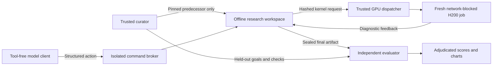

# Protocol

## Historical recovery

Each task has an exact predecessor tree and a separately held later improvement. A curator fetches and hashes inputs before a trial. An actor receives only the predecessor, public task rules, dependencies and numeric objective. The historical next improvement is a target, not a hint about the method. Alternative valid constructions remain eligible.

The research clock includes inference, shell commands and diagnostic queue waits. Compilation and source-defined weight preparation/autotuning during final evaluation are outside that research clock; the sealed candidate may contain a bounded data-independent prepare-time tuner, as permitted by the kernel interface. Record evaluation cost separately when comparing end-to-end costs. It stops at 1,800 seconds. Each model starts with a new workspace and inference session, without other models' transcripts or artifacts. A submission is sealed only when the required files are checkpointed during the clock. Evaluation may happen afterward, but cannot repair the artifact. Time to recovery is the checkpoint time of an artifact later admitted by independent evaluation; self-reported completion is a different timestamp. No submission by the cap is a right-censored observation. Provider-capacity interruptions and a CLI transport-diagnostic classification bug are retained as infrastructure exclusions; a fresh full-budget trial replaces only an infrastructure-invalid cell, never an unsuccessful research outcome. Native tool execution remains disallowed.

For kernels, the selected endpoint is the final sealed source version. Its timestamp is the earliest in-budget checkpoint containing byte-identical code. Earlier different versions are not exhaustively evaluated; the reported time is time to an admitted final artifact, not a proof that no earlier breakthrough existed. This policy limits duplicate GPU work.

The first pilot uses high reasoning with exact IDs in the result data. GPT‑5.6 means the tested `gpt-5.6-sol` variant. The initial CPU comparison ran three independent actors concurrently. Kernel concurrency and shared-GPU queue waits are recorded in the kernel cohort manifest. These affect wall-clock comparisons. The suite does not claim control over hidden provider scheduling, historical training exposure or model-level variance.

## Isolation boundary

The networked inference client returns only a validated `{command, done, note}` JSON action. Native shell, search, MCP, apps, plugins, memory and other-agent tools are disabled. Any native tool event invalidates a trial. The client has a fresh private configuration and restricted filesystem visibility. It receives the action transcript, not the curator tree.

On macOS, a separate Seatbelt command process denies all networking, including localhost and DNS. Read permissions cover its own historical workspace and installed system/dependency paths; writes cover only that workspace. Credential files, other trials, live project checkouts, future commits, curator data, process listings and indirect symlink paths are denied. Preflight tests require successful local computation/compilation and denied attempts at forbidden reads and connections. Environment variables do not carry provider or model credentials into the command broker.

For GPU work, the trusted host stages the actor's hashed kernel and public problem files into a fresh private provider sandbox with `networkBlockAll=true`. Each job runs with a distinct unprivileged UID, clean environment, private 0700 work/cache directories and `no_new_privs`. A private unprivileged supervisor owns completion writes and disables dumping/ptrace access to itself. Coordinator reads reject symlinks, hard links, unexpected owners and oversized outputs. CUDA initializes before candidate import; seccomp TSYNC then denies IPv4/IPv6 sockets in all existing and future threads. Other-job files and root-owned control data are inaccessible through standard UID permissions. A public dependency cache may be warmed before actors run; private optimized-kernel caches and actor caches must never be shared. No model credentials, production files or live challenge Git repository are uploaded.

This is an operational research-isolation protocol, not a general security certification for malicious native GPU code. It assumes the provider's VM boundary, Linux UID permissions, seccomp and macOS Seatbelt work as tested. Kernel/runtime vulnerabilities, covert channels and model-provider internals are outside the pilot's assurance. A failed boundary check stops execution. Secret reference code and actor jobs should use separate leases; private reference source is never put in an actor's bundle.

## Admission

Integer multiplication requires the exact target rational, unchanged frozen inputs, a complete finite witness and all eight mandatory verification stages. The pilot independently replayed the trusted reference and checked that admitted frame witnesses have exactly the same canonical rational row spaces, raw-input binding and accounting as that replay. Candidate-generated PASS labels are not the oracle. This specialized equivalence route does not adjudicate arbitrary different constructions; those require their own independent full replay. It proves a finite conditional improvement, not the inherited all-size compiler or analytic interfaces.

Quasi-RH requires exact continuous-domain interval certification under the retained H1–H5 assumptions. Van der Waerden, unit-distance and Sidorenko require mathematical proof review as well as their finite checks. Explicit unresolved geometric/analytic premises cannot be promoted into established improvements. Pending review is neither a pass nor a measured failure.

Kernel admission requires all public shapes to pass on two independent hidden weight/input banks. Original weights remain separate from candidate preparation, outputs match baseline dtype/shape contracts, and captured graphs must return correct results after activation values change. Final MoE checks also change routing IDs and weights, then restore the original routing metadata before measuring so the frozen timing workload stays the same. Correctness collection happens outside timing. Timing uses randomized paired replay blocks. Before each side’s block, the worker zero-fills a 64 MiB buffer outside timing. It then times up to 20 graph replays in one event interval (default 10), so later replays in that block may use warmed caches; cold L2 on every replay is not established. A case uses the ratio of the five baseline/candidate block-time medians. The aggregate is the weighted sum of per-case median microseconds; speedup is baseline aggregate divided by candidate aggregate, then the geometric mean across banks. Unlike the official challenge, this pilot does not use per-load geometric aggregation, per-replay cache eviction, a fixed graph-cost subtraction, the organizer’s entire edge-case suite, or its minimum uncertainty floor. Reference and contestant targets use this same local protocol. These differences are material when interpreting kernel speedups.

The primary kernel cutoff is now a measured aggregate speedup **strictly greater than 1.01× versus baseline**, after correctness and source-rule admission. The one-sided 95% bootstrap lower bound is reported as a separate timing-support field; it does not silently replace the requested point-estimate cutoff. Baseline-identical source is flagged explicitly: a measured timing deviation from unchanged code is not an algorithmic improvement. Time to measured speedup is the earliest in-budget checkpoint containing the exact evaluated source, with final-source-only selection as described above.

This v2 criterion was requested after the initial results were published and is a retrospective rescore of the same artifacts and measurements. The initial actors pursued historical reference targets. The original criterion—95% lower bound at least 98% of our calibrated reference speedup—was frozen before those trials and remains a secondary metric, with the original policy and results archived. Future actors receive the new baseline-progress objective. [gpu/scoring-policy.json](gpu/scoring-policy.json) is authoritative. Bootstrap intervals describe timing variation conditional on measured banks, not variation between research trials. Source audits continue to reject output caching, skipped intermediates, unsupported precision changes, checker/timer manipulation and private-data access.

## Reporting

Keep execution status, correctness, source audit, objective value, target recovery, checkpoint time, evaluation time, queue waits and infrastructure errors separate. Never substitute submission time for admitted recovery time. Never assign zero speedup to absent measurements or count a provisioning failure as model failure. Publish the exact model/harness/environment identifiers and source hashes with each result. Preserve unsuccessful attempts, excluding credentials and private account logs.

The curated reference implementations for kernels are not distributed. Their source hashes and calibration measurements establish the secondary historical targets; full reconstruction of those targets is limited without the private source. The primary 1.01× cutoff uses the distributed baseline and does not require private reference code. The open runner, public workloads, candidate sources, held-out evaluation and charts remain independently runnable. These scores are not official OKC leaderboard results.
