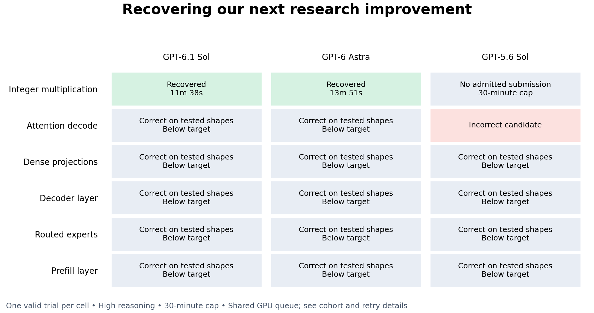
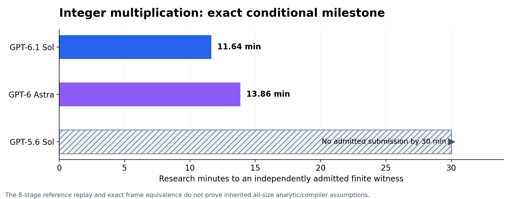
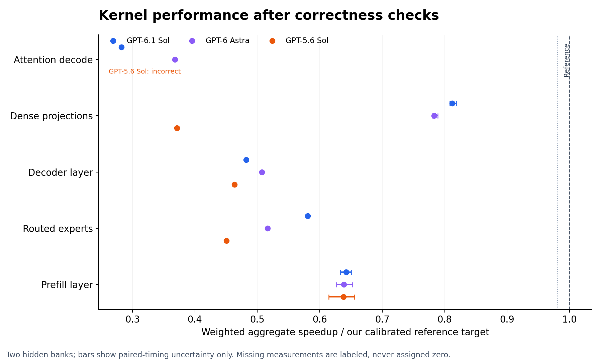

# Initial benchmark results

One valid trial per model/task, high reasoning, with a 30-minute cap. Kernel trials use a shared serialized H200 queue; replacement cohorts after provider/harness infrastructure failures have different concurrency. This pilot does not establish a model ranking.

| Task | Model | Outcome | Admitted final artifact at | Speedup vs baseline |
|---|---|---|---:|---:|
| Integer multiplication | GPT-6.1 Sol | pass | 11.64 min | — |
| Integer multiplication | GPT-6 Astra | pass | 13.86 min | — |
| Integer multiplication | GPT-5.6 Sol | right_censored_no_submission | — | — |
| Attention decode | GPT-6.1 Sol | below_target | — | 0.647x |
| Attention decode | GPT-6 Astra | below_target | — | 0.842x |
| Attention decode | GPT-5.6 Sol | incorrect | — | — |
| Dense projections | GPT-6.1 Sol | below_target | — | 1.128x |
| Dense projections | GPT-6 Astra | below_target | — | 1.088x |
| Dense projections | GPT-5.6 Sol | below_target | — | 0.516x |
| Decoder layer | GPT-6.1 Sol | below_target | — | 1.044x |
| Decoder layer | GPT-6 Astra | below_target | — | 1.099x |
| Decoder layer | GPT-5.6 Sol | below_target | — | 1.003x |
| Routed experts | GPT-6.1 Sol | below_target | — | 1.424x |
| Routed experts | GPT-6 Astra | below_target | — | 1.267x |
| Routed experts | GPT-5.6 Sol | below_target | — | 1.105x |
| Prefill layer | GPT-6.1 Sol | below_target | — | 1.007x |
| Prefill layer | GPT-6 Astra | below_target | — | 1.001x |
| Prefill layer | GPT-5.6 Sol | below_target | — | 1.001x |

Integer admissions are exact finite conditional witnesses, with the trusted reference independently replayed through all eight mandatory stages. They do not prove the inherited all-size compiler or analytic interfaces. GPT‑5.6 reached the cap without a sealed submission.

Kernel admission requires both fresh banks to pass all public workload shapes, source-rule review and the predeclared timing threshold. The benchmark metric differs from the official OKC leaderboard. No official submission was made.

## Additional mathematical trials

| Task | Model | Evidence | Outcome |
|---|---|---|---|
| quasi-rh-nested-levels | GPT-6.1 Sol | independent_exact_frozen_verifier | pass |
| quasi-rh-nested-levels | GPT-6 Astra | independent_exact_frozen_verifier | pass |
| quasi-rh-nested-levels | GPT-5.6 Sol | independent_exact_frozen_verifier | pass |
| van-der-waerden-balance-dilation | GPT-6.1 Sol | submitted_proof_unadmitted | pending_review |
| van-der-waerden-balance-dilation | GPT-6 Astra | submitted_proof_unadmitted | pending_review |
| van-der-waerden-balance-dilation | GPT-5.6 Sol | submitted_proof_unadmitted | pending_review |
| unit-distance-grid | GPT-6.1 Sol | conditional_argument_review_plus_reference_algebra_checks | pass |
| unit-distance-grid | GPT-6 Astra | conditional_argument_review_plus_reference_algebra_checks | pass |
| unit-distance-grid | GPT-5.6 Sol | conditional_argument_review_plus_reference_algebra_checks | pass |
| sidorenko-residual | GPT-6.1 Sol | activation_geometry_dependency_unresolved | unscored_pending_source_review |
| sidorenko-residual | GPT-6 Astra | activation_geometry_dependency_unresolved | unscored_pending_source_review |
| sidorenko-residual | GPT-5.6 Sol | activation_geometry_dependency_unresolved | unscored_pending_source_review |

Quasi-RH admits exact arithmetic under H1–H5; unit-distance admits a conditional argument after non-formal curator review plus exact reference algebra checks. Neither is a complete formal theorem or a new headline exponent. Van der Waerden requires further proof review. Sidorenko remains unscored while the activation-geometry provenance is unresolved.

## Reproduce and inspect

See [setup](README.md), [protocol](PROTOCOL.md), [source data](data/results.json), [CSV](data/results.csv), [reference calibration](data/calibrated-targets.json), [cohort metadata](data/cohort.json) and [chart source](tools/chart.py) and [GPU deletion accounting](data/gpu-lifecycle.json). Successful and unsuccessful sealed kernel sources and their held-out measurements are included under data/candidates. Published mathematical proofs are bound to sealed in-budget checkpoints. The admitted integer retiming witnesses and replay receipt are included; large generated replay intermediates are reconstructed from setup rather than committed. Mathematical proof submissions are research artifacts; their presence is not an admission.

## Limits

- One valid research trial per cell; timing bootstrap intervals describe GPU measurement variation only.
- Up to three selected-case GPU diagnostics per initial trial; final validation selects the final sealed source version.
- Kernel queue and provider waits count against research time. Initial and replacement cohort concurrency differs.
- 4 infrastructure-invalid attempts are excluded and replaced, with the exclusion reasons preserved in the result data.
- The initial private prototype and portable release have different source hashes. The release fixes transport-diagnostic classification, preserves bounded capacity retries and makes paths/provider configuration portable; the task semantics and scoring rule remain documented.
- Private optimized reference source is not distributed; exact original target reconstruction requires that source separately.
- Historical public exposure can contaminate model training despite runtime isolation.
