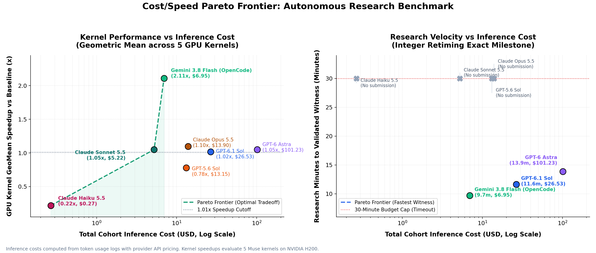

# Initial benchmark results

Kernel success now means a correct, source-compliant **measured speedup strictly greater than 1.01× versus baseline**. The GPT rows are a retrospective rescore of the original pilot (same sources, timings and timestamps; those actors pursued larger historical-reference targets). The Gemini 3.8 Flash rows use OpenCode (`opencode-v2`). The Claude rows are new trials under the same task snapshots, prompts, GPU dispatcher, judge and scoring policy, with a different inference client and host broker (`claude-cli-broker-linux-v1`; see below).

**23 of 35 kernel cells exceed the measured cutoff; 23 also have a one-sided 95% timing lower bound above it.** All cutoff-crossing measurements also have timing lower bounds above 1.01×. The prefill measurements do not qualify. Two GPT-5.6 sources are AST-identical to the baseline; their small measured deviations are controls, not evidence of algorithmic progress. No Claude source is AST-identical to its baseline.

One valid trial per model/task, high reasoning, with a 30-minute cap. Shared queue waits, infrastructure replacements, different cohort concurrency and different harnesses limit model comparisons.

## Cost vs Speed Pareto Frontier

*Inference costs computed from token usage logs with provider API pricing. Kernel speedups evaluate 5 Muse kernels on NVIDIA H200.*

| Model | Total Cohort Cost ($) | GPU Kernel GeoMean Speedup | Peak Kernel Speedup | Integer Milestone Time |
|---|---:|---:|---:|---:|
| **Claude Haiku 5.5** | **$0.27** | 0.22× (failed 2 kernels) | 1.09× | Stopped early (no submission) |
| **Claude Sonnet 5.5** | **$5.22** | 1.05× | 1.09× | Stopped early (no submission) |
| **Gemini 3.8 Flash (OpenCode)** | **$6.95** | **2.11× (Dominates all)** | **2.65×** | **9m 42s (Fastest Witness)** |
| **GPT-5.6 Sol** | **$13.15** | 0.78× | 1.11× | 30m timeout (no submission) |
| **Claude Opus 5.5** | **$13.90** | 1.10× | 1.21× | Stopped early (no submission) |
| **GPT-6.1 Sol** | **$26.53** | 1.02× | 1.42× | 11m 38s |
| **GPT-6 Astra** | **$101.23** | 1.05× | 1.27× | 13m 52s |

## Kernel speedup and research time

Time is the earliest in-budget checkpoint containing the exact final source that was evaluated. Earlier different source versions were not exhaustively evaluated, so this is **time to the measured final artifact**, not proof of the earliest possible speedup. Total trial duration and exact seconds remain in the JSON/CSV.

| Task | Model | Measured speedup | Time to measured artifact | >1.01× | 95% lower bound > cutoff | Source note |
|---|---|---:|---:|---|---|---|
| Attention decode | GPT-6.1 Sol | 0.646674× | 22m 01.34s | No | No | Reviewed source |
| Attention decode | GPT-6 Astra | 0.841710× | 23m 38.49s | No | No | Reviewed source |
| Attention decode | GPT-5.6 Sol | — | — | No | — | Compilation failure |
| Attention decode | Gemini 3.8 Flash (OpenCode) | 2.653700× | 14m 05.22s | Yes | Yes | Reviewed source |
| Attention decode | Claude Opus 5.5 | 1.084239× | 3m 56.20s | Yes | Yes | Reviewed source |
| Attention decode | Claude Sonnet 5.5 | 1.085880× | 1m 11.46s | Yes | Yes | Reviewed source |
| Attention decode | Claude Haiku 5.5 | 1.090654× | 2m 17.19s | Yes | Yes | Reviewed source |
| Dense projections | GPT-6.1 Sol | 1.127900× | 27m 36.72s | Yes | Yes | Reviewed source |
| Dense projections | GPT-6 Astra | 1.088004× | 18m 03.22s | Yes | Yes | Reviewed source |
| Dense projections | GPT-5.6 Sol | 0.515899× | 16m 14.39s | No | No | Reviewed source |
| Dense projections | Gemini 3.8 Flash (OpenCode) | 1.560100× | 17m 04.18s | Yes | Yes | Reviewed source |
| Dense projections | Claude Opus 5.5 | 1.118973× | 7m 44.77s | Yes | Yes | Reviewed source |
| Dense projections | Claude Sonnet 5.5 | 1.061558× | 2m 30.07s | Yes | Yes | Reviewed source |
| Dense projections | Claude Haiku 5.5 | 1.040494× | 7m 12.89s | Yes | Yes | Reviewed source |
| Decoder layer | GPT-6.1 Sol | 1.044181× | 23m 55.46s | Yes | Yes | Reviewed source |
| Decoder layer | GPT-6 Astra | 1.098858× | 22m 22.85s | Yes | Yes | Reviewed source |
| Decoder layer | GPT-5.6 Sol | 1.002899× | 12m 35.59s | No | No | Unchanged baseline AST |
| Decoder layer | Gemini 3.8 Flash (OpenCode) | 2.172400× | 19m 02.69s | Yes | Yes | Reviewed source |
| Decoder layer | Claude Opus 5.5 | 1.033034× | 3m 11.37s | Yes | Yes | Reviewed source |
| Decoder layer | Claude Sonnet 5.5 | 1.019289× | 0m 45.81s | Yes | Yes | Reviewed source |
| Decoder layer | Claude Haiku 5.5 | 0.007254× | 1m 12.45s | No | No | Reviewed source |
| Routed experts | GPT-6.1 Sol | 1.424259× | 22m 46.48s | Yes | Yes | Reviewed source |
| Routed experts | GPT-6 Astra | 1.266741× | 26m 54.08s | Yes | Yes | Reviewed source |
| Routed experts | GPT-5.6 Sol | 1.105026× | 11m 42.67s | Yes | Yes | Reviewed source |
| Routed experts | Gemini 3.8 Flash (OpenCode) | 2.376800× | 16m 28.35s | Yes | Yes | Reviewed source |
| Routed experts | Claude Opus 5.5 | 1.209326× | 3m 59.72s | Yes | Yes | Reviewed source |
| Routed experts | Claude Sonnet 5.5 | 1.077999× | 2m 01.14s | Yes | Yes | Reviewed source |
| Routed experts | Claude Haiku 5.5 | — | — | No | — | Compilation failure |
| Prefill layer | GPT-6.1 Sol | 1.007282× | 20m 31.97s | No | No | Reviewed source |
| Prefill layer | GPT-6 Astra | 1.001426× | 15m 55.36s | No | No | Reviewed source |
| Prefill layer | GPT-5.6 Sol | 1.001131× | 12m 55.68s | No | No | Unchanged baseline AST |
| Prefill layer | Gemini 3.8 Flash (OpenCode) | 1.956200× | 20m 10.45s | Yes | Yes | Reviewed source |
| Prefill layer | Claude Opus 5.5 | 1.052940× | 8m 04.47s | Yes | Yes | Reviewed source |
| Prefill layer | Claude Sonnet 5.5 | 1.003396× | 0m 30.50s | No | No | Reviewed source |
| Prefill layer | Claude Haiku 5.5 | 0.087702× | 2m 26.13s | No | No | Reviewed source |

The old “below target” label meant below our calibrated historical references (about 1.39×–2.45×), not necessarily slower than baseline. No candidate recovered those original reference targets. They remain a secondary metric in the JSON; the [original results](data/results-historical-target-v1.json), [original scoring policy](gpu/scoring-policy-historical-v1.json) and [calibration traces](data/calibrated-targets.json) are preserved.

These are local H200 measurements, not official OKC leaderboard scores. The requested raw cutoff does not establish that tiny gains are real; timing support and unchanged-code controls are reported separately.

## Integer multiplication

| Model | Outcome | Time to admitted witness |
|---|---|---:|
| GPT-6.1 Sol | pass | 11m 38.49s |
| GPT-6 Astra | pass | 13m 51.80s |
| GPT-5.6 Sol | right_censored_no_submission | — |
| Gemini 3.8 Flash (OpenCode) | pass | 9m 42.14s |
| Claude Opus 5.5 | stopped_without_submission | — |
| Claude Sonnet 5.5 | stopped_without_submission | — |
| Claude Haiku 5.5 | stopped_without_submission | — |

Integer admissions are exact finite conditional witnesses, with the trusted reference independently replayed through all eight mandatory stages. They do not prove inherited all-size compiler or analytic interfaces. GPT-5.6 reached the cap without a sealed submission. All three Claude models stopped before the cap without sealing a submission.

## Additional mathematical trials

| Task | Model | Evidence | Outcome |
|---|---|---|---|
| quasi-rh-nested-levels | GPT-6.1 Sol | independent_exact_frozen_verifier | pass |
| quasi-rh-nested-levels | GPT-6 Astra | independent_exact_frozen_verifier | pass |
| quasi-rh-nested-levels | GPT-5.6 Sol | independent_exact_frozen_verifier | pass |
| van-der-waerden-balance-dilation | GPT-6.1 Sol | submitted_proof_unadmitted | pending_review |
| van-der-waerden-balance-dilation | GPT-6 Astra | submitted_proof_unadmitted | pending_review |
| van-der-waerden-balance-dilation | GPT-5.6 Sol | submitted_proof_unadmitted | pending_review |
| unit-distance-grid | GPT-6.1 Sol | conditional_argument_review_plus_reference_algebra_checks | pass |
| unit-distance-grid | GPT-6 Astra | conditional_argument_review_plus_reference_algebra_checks | pass |
| unit-distance-grid | GPT-5.6 Sol | conditional_argument_review_plus_reference_algebra_checks | pass |
| sidorenko-residual | GPT-6.1 Sol | activation_geometry_dependency_unresolved | unscored_pending_source_review |
| sidorenko-residual | GPT-6 Astra | activation_geometry_dependency_unresolved | unscored_pending_source_review |
| sidorenko-residual | GPT-5.6 Sol | activation_geometry_dependency_unresolved | unscored_pending_source_review |

## Claude models: harness differences

The Claude rows use harness `claude-cli-broker-linux-v1`, recorded as a distinct harness version. Inference is the Claude Code CLI in print mode with every built-in tool disabled, no MCP servers and no settings or memory files; it returns the same `{command, done, note}` action through `--json-schema`, and any other tool event invalidates the trial. Commands run in a Linux namespace broker (uid 65534; fresh mount, network, pid, ipc and uts namespaces; read-only system directories and venv; read-write trial workspace only; no network) instead of macOS Seatbelt. Prompts are identical except “Your Mac shell” → “Your Linux shell”. GPU diagnostics, final two-bank evaluation, the judge and the scoring policy are unchanged; lease provisioning is retried up to three times as an infrastructure measure. Kernel trials ran five at a time on one shared H200 queue. Source audits for these rows were performed by the operating Claude session (diff review plus an AST scan for cross-call state, caching, file access and timer/checker patching).

Earlier Claude attempts are excluded as infrastructure-invalid and listed in `infrastructure_exclusions`: two host-session suspensions that killed running trials, one cohort in which diagnostic results were unreadable by the sandboxed actor (a bug in the Linux port, since fixed) and one cohort hit by a Daytona H200 provisioning outage. Each was replaced by a fresh full-budget trial; no unsuccessful research outcome was replaced.

Quasi-RH admits exact arithmetic under H1–H5; unit-distance admits a conditional argument after non-formal curator review plus exact reference algebra checks. Neither is a complete formal theorem or a new headline exponent. Van der Waerden proof review and Sidorenko activation-geometry provenance remain unresolved and unscored.

## Reproduce and inspect

[Setup](README.md) · [Protocol](PROTOCOL.md) · [JSON](data/results.json) · [CSV](data/results.csv) · [Cohort metadata](data/cohort.json) · [Chart source](tools/chart.py) · [Table source](tools/render_results.py) · [GPU deletion accounting](data/gpu-lifecycle.json)

Sealed kernel sources, two-bank measurements, mathematical proof hashes and integer witnesses are published. Private optimized reference sources and raw credential/client logs are excluded. Research isolation cannot eliminate historical training contamination. Four infrastructure-invalid attempts were excluded and replaced; these remain documented in the data.
