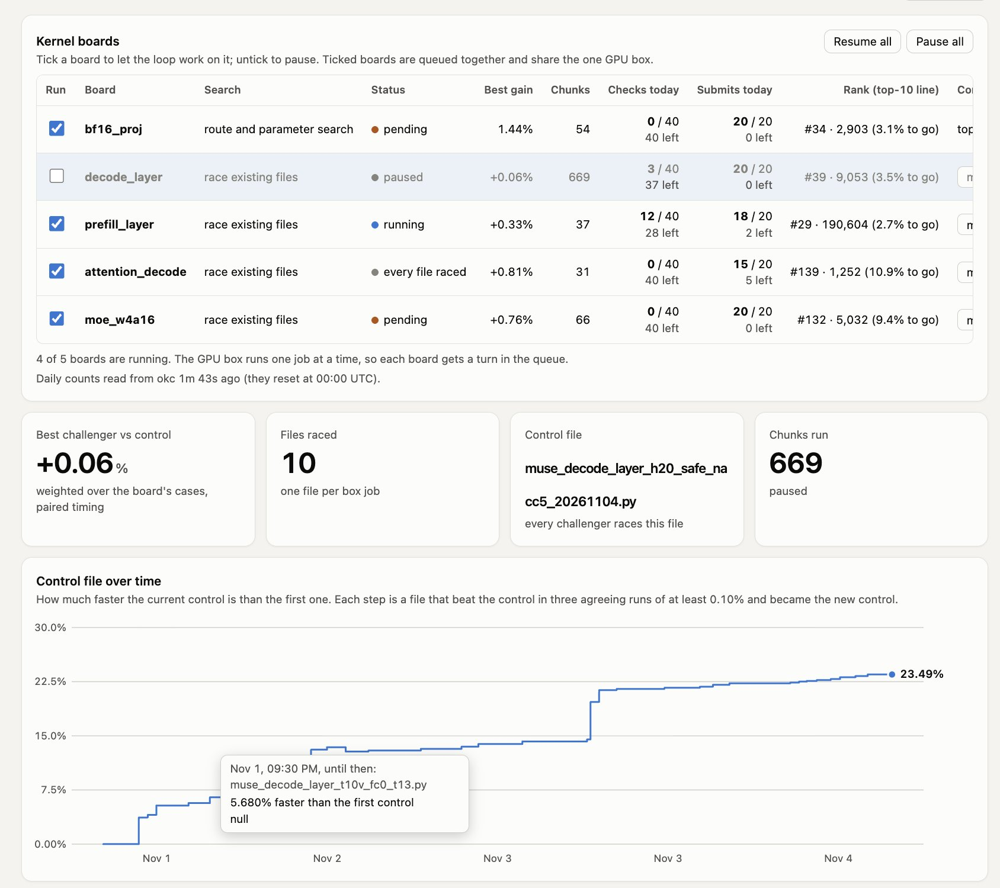

# Portable racing genetic optimizer

This is a dependency-free port of the per-cell racing loop used for Open Kernel
Challenge work into the Auto-research-agent repository.  It is a **script
first** tool: the macOS app is not required, and there is no model call, account,
API key, CUDA requirement or third-party Python package in the engine.

The engine decides what to measure, when a difference is statistically
significant, and when a champion may be replaced.  A target-specific **adapter**
supplies the cells, genes, builds and paired timing measurements.  A synthetic
adapter is included for local verification; its timings are fabricated and are
not kernel measurements.

This directory contains code and synthetic fixtures only.  It ships no agent
traces, transcripts, benchmark results, model weights or private datasets.
Adapters and cells are supplied by the person running it, from a public baseline
or from a new target they choose.



The screenshot above is the production **Kernel boards** view the port is based
on: one board per kernel, each board racing candidate files against a shared
control file on a single GPU box, with the bottom chart tracking confirmed
control-file gains over time.  It is illustrative of the workflow, not output
from this portable engine; the local demo's timings are synthetic.

## Quick start (macOS, Linux or Windows)

Python 3.9 or newer is enough for the demo:

```sh
git clone https://github.com/rohanarun/Auto-research-agent.git
cd Auto-research-agent
python3 benchmarks/tools/run_ga.py demo --fresh
```

On Windows, use `py -3` or `python` if `python3` is not on `PATH`; the same
commands work unchanged otherwise.

Or call the package directly from the repository root:

```sh
python3 -m benchmarks.ga demo --fresh --cells 6 --generations 5
```

The demo writes `tmp/ga-demo/state.json` and `tmp/ga-demo/summary.json` (use
`--state` to choose another location).  It prints a live race/hill-climb log and
a final champion table.  `--quiet` suppresses the live log; `--json` prints the
final summary as JSON.

A saved state can be inspected or exported without rerunning:

```sh
python3 -m benchmarks.ga status --state tmp/ga-demo/state.json
python3 -m benchmarks.ga export --state tmp/ga-demo/state.json --output tmp/ga-demo/best.json
```

## Algorithm

The port keeps the decisions from the production loop:

1. **Generation 0.** Build every initial gene for every cell, then race them with
   successive elimination on paired per-block log-time ratios.  The reference
   for each block is the median across surviving genes, so shared machine noise
   cancels.  A gene survives when
   `mean(log(gene / best)) < max(3.0 * SE, 0.2%)`.
2. **Fresh-input confirmation.** The race winner is re-measured against the
   `t10` baseline on new inputs.  It becomes champion only when
   `rel < 0.997` and the 95% confidence upper bound is `< 1.0`.  Otherwise the
   baseline remains champion.
3. **Hill climbing.** Later generations propose mutants per cell.  A mutant is
   measured against the incumbent in paired blocks; it proceeds only when
   `mean(log(mutant / incumbent)) < -max(2.5 * SE, 0.3%)`.  It replaces the
   incumbent only after the same fresh-input confirmation gate.
4. **Monotonic state.** A champion is replaced only by a confirmed improvement.
   The stored relative time is multiplied by each accepted confirmation, so the
   reported measured gain cannot fall after a confirmed improvement.
5. **Crash safety.** A risky gene is written to `pending` before its build.  If
   the process dies, the restart driver blacklists exactly that gene and starts
   a fresh process.  State writes are atomic (`state.json.tmp` + `os.replace`).

The engine never decides that a result is a valid kernel submission.  Correctness,
source-rule compliance and final held-out evaluation remain separate, exactly as
in the repository's kernel protocol.  The demo only establishes that the loop
runs.

## Using a real target

An adapter is a small object with these methods:

```python
from benchmarks.ga.engine import BuildResult, Cell, ConfirmResult, Gene, GAState

class Adapter:
    def cells(self):
        return [Cell(key="router|m=1", layer="router", m=1, n=4096, k=8192)]

    def initial_genes(self, cell):
        return [
            Gene("t10", ["baseline"]),
            Gene("cublas", ["anchor"], selectable=False),
            Gene("main:1", ["main", 1]),
        ]

    def mutants(self, cell, incumbent, known, state, rng):
        # Return zero or more proposed genes.  The engine tries at most three
        # per cell per generation and filters known/blacklisted names.
        return [Gene("rk:S8", ["rk", 8], risky=True)]

    def build(self, cell, gene):
        # Compile/capture the candidate and check its numerical contract.
        # Raise StickyFault(gene_id) if only a fresh process can recover.
        return BuildResult(ok=True, bit=True)

    def drop(self, cell, name):
        pass

    def measure(self, cell, names, blocks):
        # Return {name: [one positive timing per paired block]}.
        # Randomise order and flush caches outside the timed region.
        return {name: [100.0] * blocks for name in names}

    def confirm(self, cell, champion, base, blocks):
        # Fresh inputs; return the champion/base ratio and its 95% interval.
        return ConfirmResult(rel=0.99, lo=0.989, hi=0.991,
                             t_champion=99.0, t_base=100.0)

    def close(self):
        pass
```

Adapters can be loaded by module path:

```sh
python3 benchmarks/tools/run_ga.py run \
  --adapter my_adapter:make_adapter \
  --state tmp/ga/state.json \
  --seconds 1800
```

or by file path (the factory defaults to `make_adapter`):

```sh
python3 benchmarks/tools/run_ga.py run \
  --adapter ./my_adapter.py:make_adapter \
  --state tmp/ga/state.json
```

The launcher puts both the repository root and `benchmarks/` on the import path,
so an adapter may import from either `benchmarks.ga.engine` or `ga.engine`. The
engine normalizes `Gene`, `BuildResult` and `ConfirmResult` objects across those
two import names.

### Evaluator requirements

The adapter owns the physical measurement.  It must:

* return paired blocks for every requested gene, with one positive value per
  block;
* randomise measurement order and perform any cache flush **outside** the timed
  region;
* use fresh inputs for `confirm`, and compute `rel` and `hi` from paired
  champion/base log ratios; when `champion == base`, return `rel = hi = 1.0`
  and a valid `t_base` (generation 0 uses this short confirmation);
* preserve the original dtype, shape and correctness contract of the target;
* raise `StickyFault(gene_id)` when a build fault requires a fresh process;
* avoid reading credentials, other jobs' files or live production data.

For an in-process CUDA graph adapter, import Torch inside the adapter and keep
the graph handles there.  For a stateless remote evaluator, the JSON command
adapter below is usually simpler.

## Bundled GPU adapters

The engine itself stays dependency-free.  Two optional adapters run real
measurements: `torch_gpu.py` on a local CUDA or Apple MPS device, and
`daytona.py` through the repository's existing H200 harness.

### Local CUDA / Apple MPS demo

`torch_gpu.py` imports PyTorch only when the adapter is constructed.  It runs
real paired timings, checks the candidate output against the baseline, flushes
caches outside the timed region, and randomises which implementation is timed
first.  The default target includes batched GEMMs whose baseline is a Python
loop of `torch.mm` calls; `torch.bmm` and `torch.matmul` are real candidate
implementations, not simulated costs.

```sh
# Install a CUDA or Apple MPS build of PyTorch first.
python3 benchmarks/tools/run_ga.py gpu-demo \
  --fresh --device auto --cells 3 --generations 2 \
  --replays 50 --warmup 5 --flush-mb 32
```

Useful options:

| Option | Meaning |
|---|---|
| `--device auto|cuda|mps|cpu` | `auto` requires a GPU; `cpu` is an explicit, labelled fallback |
| `--dtype auto|float16|bfloat16|float32` | `auto` picks a dtype supported by the device |
| `--replays N` | Kernel calls inside each timed block |
| `--warmup N` | Warmup calls before timing |
| `--flush-mb N` | Cache-flush buffer in MiB, zeroed outside the timed region |
| `--per-round`, `--race-rounds`, `--mutation-blocks`, `--confirm-blocks` | GA measurement budget |

The run writes `tmp/ga-gpu/state.json` and `tmp/ga-gpu/summary.json`.  It prints
the measured device, dtype and gain.  This is a real microbenchmark of local
PyTorch calls, **not** the official H200 judge and not a leaderboard result.

### Daytona H200 adapter

`daytona.py` maps the public benchmark cases in
`benchmarks/gpu/specs/<problem>.json` to GA cells and maps candidate source
files to genes.  The first candidate is the initial gene; each later candidate
is a mutant.  One measured gene/case pair is one job on the existing harness:

* `benchmarks/gpu/dispatcher.py` creates or attaches to a lease;
* `benchmarks/gpu/session.py` uploads one candidate and the public judge files;
* `benchmarks/gpu/judge.py` checks correctness and produces paired CUDA-graph
  timings against the official `baseline.py` from the same job.

The candidate must be a UTF-8 Python file that defines `kernel_fn`.  A
20-line adapter file is enough:

```python
from benchmarks.ga.daytona import DaytonaAdapter


def make_adapter():
    return DaytonaAdapter(
        problem="muse_bf16_proj",
        candidates=["./candidate_a.py", "./candidate_b.py"],
        cases=[0, 1],
        rounds=4,
        seconds=900,
    )
```

```sh
DAYTONA_API_KEY=... python3 benchmarks/tools/run_ga.py run \
  --adapter ./my_daytona_adapter.py:make_adapter \
  --state tmp/ga-daytona/state.json \
  --per-round 4 --mutation-blocks 4 --confirm-blocks 6
```

The same adapter can be configured without a Python factory.  Candidate paths
are separated by the platform path separator (`:` on macOS/Linux, `;` on
Windows):

```sh
export GA_DAYTONA_CANDIDATES="./candidate_a.py:./candidate_b.py"
export GA_DAYTONA_CASES="0,1"
export GA_DAYTONA_ROUNDS=4
python3 benchmarks/tools/run_ga.py run \
  --adapter benchmarks.ga.daytona:make_adapter_from_env \
  --state tmp/ga-daytona/state.json
```

#### Reuse an existing box or an existing snapshot

The normal lease builds the pinned SGLang H200 image.  Some images have more
than 69 layers and cannot be snapshotted, so the adapter also accepts an
existing sandbox or a GPU snapshot:

```python
# Restart an existing box, then stop it when the run ends.
DaytonaAdapter(..., sandbox_id="<sandbox-id>")

# Create from a snapshot UUID (or exact name), then delete it when the run ends.
DaytonaAdapter(..., snapshot="<snapshot-uuid>")

# Keep a reused box running after the run (the default is to stop it).
DaytonaAdapter(..., sandbox_id="<sandbox-id>", close_action="leave")
```

Environment equivalents are `GA_DAYTONA_SANDBOX_ID` and
`GA_DAYTONA_SNAPSHOT` (mutually exclusive).  `GA_DAYTONA_CLOSE_ACTION` accepts
`delete`, `stop` or `leave`; the default is `delete` for a snapshot box and
`stop` for an attached box.  `GA_DAYTONA_EXPECTED_GPU` overrides the GPU type
check (for example `H200` or `RTX-4090`); otherwise the snapshot or sandbox
metadata is used.

The lease starts a stopped box, verifies `nvidia-smi`, checks that the GPU
matches the expected type, and records whether networking is blocked.  It
refuses a box with networking enabled unless `require_network_block=False` (or
`GA_DAYTONA_ALLOW_NETWORK=1`) is set explicitly.  A snapshot is activated first
if it is inactive.  Snapshot creation deliberately sends **no** explicit
CPU/GPU/memory/disk resources, because Daytona rejects resources on a
snapshot-backed sandbox.

The bundled `session.run_job` requires root (`uid 0`) because it creates a
dedicated unprivileged contestant UID and chowns the job directory.  The lease
probes this and fails early with a clear message instead of discovering it
mid-run.  The official `muse_bf16_proj` baseline also imports SGLang, so the
chosen image or snapshot must contain the matching SGLang build and PyTorch
stack; a stock PyTorch snapshot is suitable for a transport smoke test, not for
an official benchmark claim.

#### Cost, isolation and credentials

* Start with one case and one or two candidates.  Each gene/case pair is a
  separate GPU job; `rounds` multiplies the work inside that job.
* The lease owns the box: `close()` deletes a snapshot-created box or stops an
  attached box even when a job raises.  `close_action="leave"` is the explicit
  opt-out.
* Keep `--seconds` bounded and run one box at a time.  A stopped box can be
  restarted for a later run.
* The sandbox has networking blocked and the candidate runs as an unprivileged
  UID with the repository's offline and Landlock guards.
* `DAYTONA_API_KEY` must be in the environment of the GA process only.  Never
  put it in an adapter file, a JSON config, a command line, a candidate file, a
  bundle or a committed result directory.  The adapter reads no credential;
  `benchmarks/gpu/daytona_control.py` reads the key only when making a request.
* The state and result directories may contain candidate sources and timing
  observations.  Keep them private unless you have deliberately reviewed what
  you are publishing.

## Command adapter (no Python adapter needed)

`benchmarks/ga/command.py` runs a user-supplied executable for each operation.
The executable receives one JSON object on stdin and must print one JSON object
on stdout.  A configuration file names the cells and genes:

```json
{
  "command": ["python3", "evaluate.py"],
  "timeout_seconds": 600,
  "cells": [
    {
      "key": "router|m=1",
      "layer": "router",
      "m": 1,
      "n": 4096,
      "k": 8192,
      "genes": [
        {"name": "t10", "spec": ["baseline"]},
        {"name": "cublas", "spec": ["anchor"], "selectable": false},
        {"name": "main:1", "spec": ["main", 1]}
      ],
      "mutants": [
        {"name": "rk:S8", "spec": ["rk", 8], "risky": true}
      ]
    }
  ]
}
```

Requests and responses:

| Operation | Request | Response |
|---|---|---|
| build | `{"op":"build","cell":...,"gene":...}` | `{"ok":true,"bit":true}` |
| measure | `{"op":"measure","cell":...,"names":[...],"blocks":N}` | `{"times":{"name":[N positives]}}` |
| confirm | `{"op":"confirm","cell":...,"champion":"...","base":"t10","blocks":N}` | `{"rel":...,"lo":...,"hi":...,"t_champion":...,"t_base":...}` |
| drop | `{"op":"drop","cell":...,"name":"..."}` | `{}` |

Every request also contains `seed` and `call`.  The command runs with the config
file's directory as its working directory unless `cwd` is set.  It must not print
logs on stdout; use stderr for diagnostics.  The command adapter is stateless
across operations, so use a Python adapter when build handles must survive.

## State and restarts

The state file is JSON with this shape:

```json
{
  "schema": "auto-research-ga-state-v1",
  "generation": 3,
  "pending": null,
  "blacklist": ["decode 16|router|16|rk:S12"],
  "champ": {
    "decode 16|router|16": {
      "gene": "rk:S8",
      "spec": ["rk", 8],
      "rel": 0.9912,
      "t10_us": 512.4,
      "det": true
    }
  },
  "cells": {"decode 16|router|16": {"n_genes": 9, "n_fail": 0, "top": []}},
  "hist": [{"gen": 2, "tried": 12, "gain_meas": 0.0088, "improved": []}]
}
```

Resume by repeating the same command with the same `--state`; saved champions
are kept and only new cells are raced.  `--rerace` redoes generation 0.
`--det-only` rejects non-bit-reproducible builds.

`--restarts N` runs the optimizer as child processes and recovers a pending gene
between attempts:

```sh
python3 benchmarks/tools/run_ga.py run \
  --config ga.json --state tmp/ga/state.json --restarts 5
```

Without the driver, a sticky fault exits with status 3.  Recover manually with:

```sh
python3 -m benchmarks.ga recover --state tmp/ga/state.json
```

## Tests

The GA tests are CPU-only and do not require the app, a model or a GPU:

```sh
python3 -m unittest discover -s benchmarks/tests -p 'test_ga_*.py' -v
```

The GitHub Actions workflow runs the same tests on Ubuntu, macOS and Windows.

## Scope and limits

* The demo's numbers are synthetic.  Do not cite them as performance.
* The engine implements selection and persistence, not a kernel-specific gene
  space.  A real gain requires an adapter with real implementation choices and
  real paired timings.
* A confirmed local improvement is not a final leaderboard result.  Run the
  repository's independent held-out validation and source audit before making a
  performance claim.
* No credentials are read or written by the engine, demo or command adapter.
  Do not put keys in an adapter or command configuration; the child inherits the
  caller's environment.
