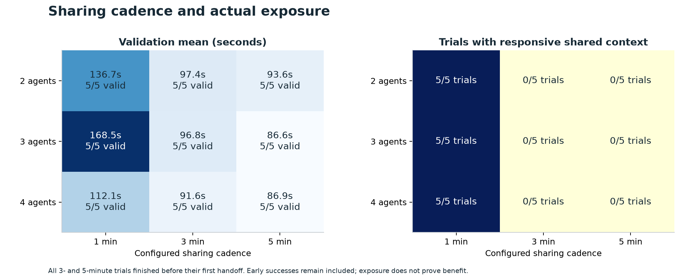
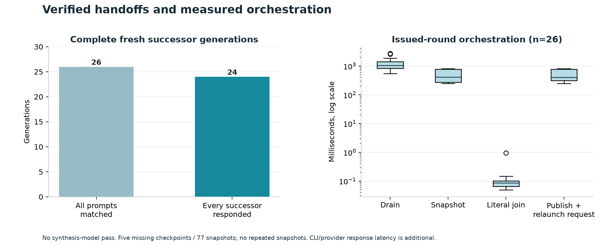
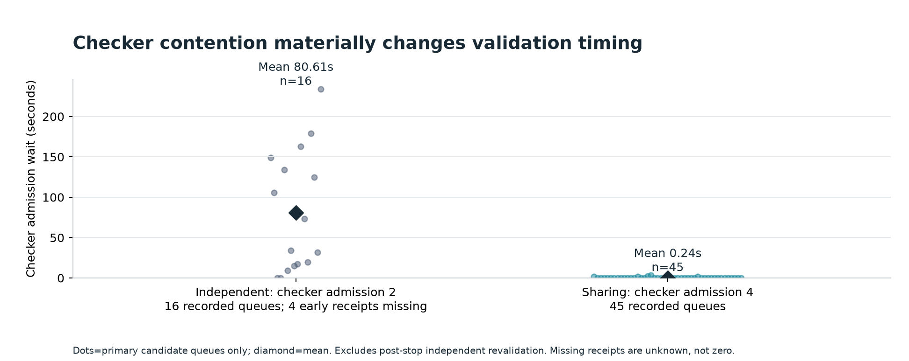
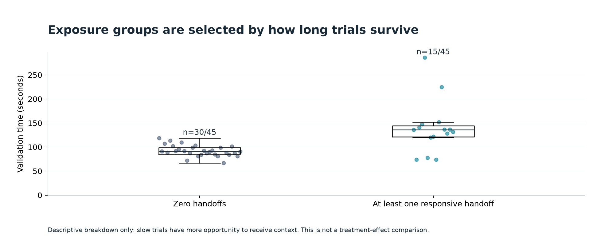
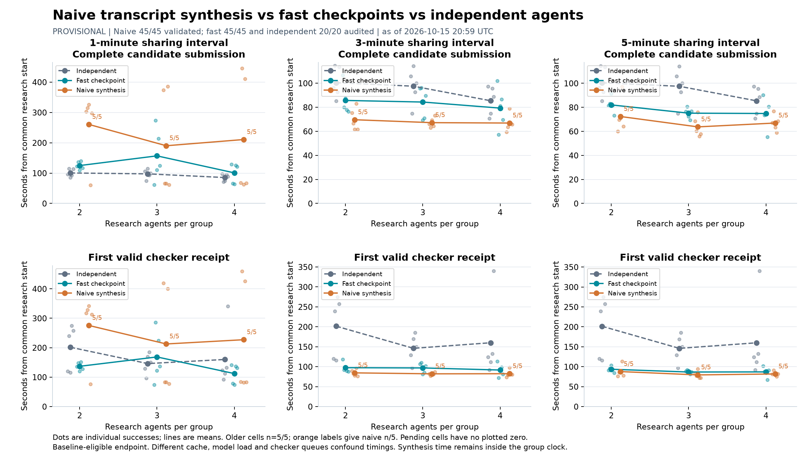

# Parallel-agent checkpoint experiments — 15 October 2026

The release ships **fast checkpoint sharing only**: agents maintain compact
checkpoint files while working; the harness drains owned processes, snapshots
those files, joins their literal contents, and launches fresh sessions with the
bundle. There is no intermediary synthesis-model call.

[Audited independent and fast-sharing report](independent-and-fast-report.pdf)
contains all 65 completed logical trials: 20 independent and 45 fast-sharing.
Machine-readable trial data and descriptive statistics are in [data](data).

All 65 valid constructions matched the eligible baseline. **No trial demonstrated
a new milestone improvement.** First frozen-checker `valid=true` was the endpoint;
validity is a conditional finite-word numeric check, not a theorem proof or a
measurement of multiplication runtime. Thirty of 45 fast-sharing successes occurred
without a handoff. Twenty-six rounds had complete prompt receipts, but only 24 had
model responses from every successor. A prompt receipt does not establish useful
research or a sharing benefit.

Different controller resources, validation admission queues, provider concurrency,
cache/account state and a user-authorized capacity retry confound timing comparisons.
These data do not establish causal benefits from sharing, diversity or agent count.
The infrastructure-failed original attempt is retained separately and excluded from
performance averages. Cached input is a subset of input; reasoning is a subset of
output; missing counters are unknown.

## Historical Mac comparison

The historical Mac arm remains partial (18/20 slots; denominators 4/5, 5/5, 4/5,
5/5 for one through four agents). The Daytona independent arm has five per count.
The chart is descriptive and retains its provisional label because the historical
arm was interrupted and its complete terminal review is not finished. Platform,
compiler, harness, provider/account/cache state, scheduling and validation queue
all differ. It must not be interpreted as a causal platform comparison.

The old transcript-synthesis sharing arm has 45/45 checker-valid slots in this
snapshot, but its full manual terminal audit is still pending. Any
included three-arm chart is explicitly an as-of provisional snapshot; the app does
not expose that older method. See the snapshot's recorded source and denominator
metadata before interpreting it.

## App release verification

The cloud execution smoke test is separate from the scientific trials above.
It ran the native app's actual Daytona adapter with two writing Codex workers and
two fresh successors. Both successors returned both injected checkpoint markers
without tool reads; four provider IDs were distinct. Owned Linux cancellation,
credential-excluded archives and every-entry/hash verification also passed.
A separate actual device-login test streamed the official URL/code into the app
and cancelled without starting research. Keychain round-trip, management-token
confinement, ownership checks and archive-tampering tests are in the source suite.
These are transport/lifecycle checks, not evidence of better research results.
