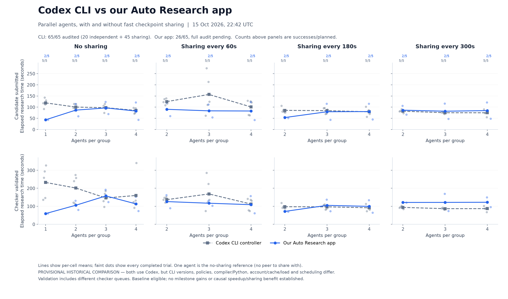
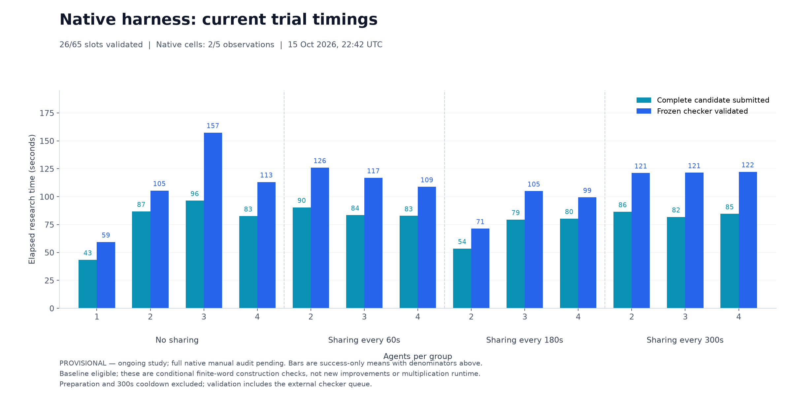

# Parallel-agent checkpoint experiments — 15 October 2026

The release ships **fast checkpoint sharing only**: agents maintain compact
checkpoint files while working; the harness drains owned processes, snapshots
those files, joins their literal contents, and launches fresh sessions with the
bundle. There is no intermediary synthesis-model call.

[Audited independent and fast-sharing report](independent-and-fast-report.pdf)
contains all 65 completed logical trials: 20 independent and 45 fast-sharing.
Machine-readable trial data and descriptive statistics are in [data](data).

All 65 valid constructions matched the eligible baseline. **No trial demonstrated
a new milestone improvement.** First frozen-checker `valid=true` was the endpoint;
validity is a conditional finite-word numeric check, not a theorem proof or a
measurement of multiplication runtime. Thirty of 45 fast-sharing successes occurred
without a handoff. Twenty-six rounds had complete prompt receipts, but only 24 had
model responses from every successor. A prompt receipt does not establish useful
research or a sharing benefit.

Different controller resources, validation admission queues, provider concurrency,
cache/account state and a user-authorized capacity retry confound timing comparisons.
These data do not establish causal benefits from sharing, diversity or agent count.
The infrastructure-failed original attempt is retained separately and excluded from
performance averages. Cached input is a subset of input; reasoning is a subset of
output; missing counters are unknown.

## Historical Mac comparison

The historical Mac arm remains partial (18/20 slots; denominators 4/5, 5/5, 4/5,
5/5 for one through four agents). The Daytona independent arm has five per count.
The chart is descriptive and retains its provisional label because the historical
arm was interrupted and its complete terminal review is not finished. Platform,
compiler, harness, provider/account/cache state, scheduling and validation queue
all differ. It must not be interpreted as a causal platform comparison.

The old transcript-synthesis sharing arm has 45/45 checker-valid slots in this
snapshot, but its full manual terminal audit is still pending. Any
included three-arm chart is explicitly an as-of provisional snapshot; the app does
not expose that older method. See the snapshot's recorded source and denominator
metadata before interpreting it.

## App release verification

The cloud execution smoke test is separate from the scientific trials above.
It ran the native app's actual Daytona adapter with two writing Codex workers and
two fresh successors. Both successors returned both injected checkpoint markers
without tool reads; four provider IDs were distinct. Owned Linux cancellation,
credential-excluded archives and every-entry/hash verification also passed.
A separate actual device-login test streamed the official URL/code into the app
and cancelled without starting research. Keychain round-trip, management-token
confinement, ownership checks and archive-tampering tests are in the source suite.
These are transport/lifecycle checks, not evidence of better research results.

## Codex CLI versus our Auto Research app: provisional comparison

Snapshot: **15 October 2026, 22:42 UTC — 26/65 native app slots independently
revalidated**, two observations of five planned per configuration. Full native
manual terminal audit and the remaining trials are pending. The earlier CLI arm
has **65/65 fully audited trials**: 20 independent and 45 fast-sharing.

The four columns compare both harnesses without sharing and with fast checkpoint
sharing every 60, 180 or 300 seconds. Rows separate candidate submission from
checker validation. Lines show means; faint dots show individual trials. Agent
counts are 1–4 without sharing and 2–4 with sharing. One agent has no peer and
serves as the no-sharing reference; no artificial one-agent sharing result is
inserted. Counts above the panels identify successes out of five planned repeats.

Both systems run Codex CLI. “Our Auto Research app” means our production native
macOS orchestration harness, not the Codex desktop app. Its benchmark creates fresh
private Daytona workers and fresh provider state; it does not benchmark a saved
interactive app chat. The earlier CLI controller also used isolated fresh workers.
The CLI version, Python/compiler, policies, account/cache/provider load, scheduling
and checker queues differ, so these historical comparisons do not establish a
causal speedup or sharing benefit.

All included successes are baseline-eligible finite constructions; no new
milestone gain is established. Preparation and the 300-second cooldown are outside
the research clock; validation includes checker admission/wait and execution.

[Trial CSV](native-harness-progress/trials.csv),
[aggregates and source hashes](native-harness-progress/aggregate.json),
[visual/data review](native-harness-progress/data-review.json), and
[vector comparison chart](native-harness-progress/codex-cli-vs-native-harness.svg)
are included for inspection. These charts remain provisional until the native
study and full audit finish.
