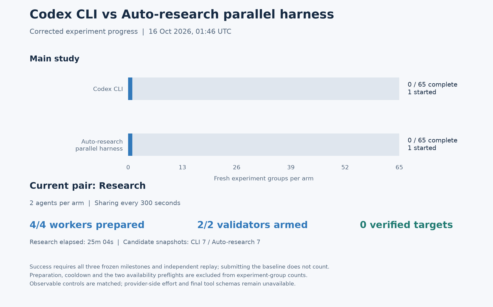

# Codex CLI vs Auto-research parallel harness

This is a timestamped progress snapshot of the new controlled experiment. The JSON supplies the plotted counts. The study has 65 fresh groups per arm: five repeats of independent 1/2/3/4 agents, and five repeats of 2/3/4 agents sharing every 60/180/300 seconds.

A target requires all three frozen mathematical milestones, a canonical nonbaseline construction and independent external replay. Baseline submissions are not successes. Historical runs are excluded. Preparation, cooldown and availability preflights are not counted as research groups.

The user approved matching observable controls while disclosing unavailable provider internals. Both arms use the same pinned CLI, initial prompt and arguments, resolved client settings, account and worker resources. Provider-side effort, final tool schemas and immutable container image digests are not independently verified. These progress counts do not establish a speed advantage.

One worker reported pausing over historical Python-version text, despite the common Linux instruction to use the installed runtime. The worker subsequently submitted candidates using the installed runtime. The earlier pause remains recorded as a run limitation; live prompts and environments remain unchanged.

[PDF](corrected-progress.pdf) · [Counts](progress-data.json)
